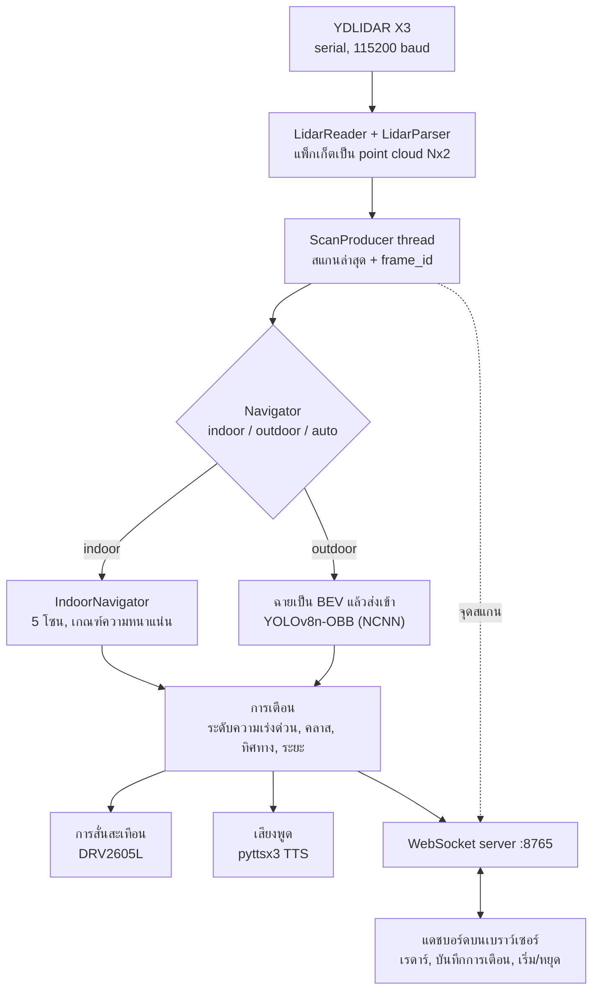

# LiDAR Navigational Aid

[English](README.md) | **ไทย**

ต้นแบบระบบตรวจจับสิ่งกีดขวางและช่วยนำทางแบบเวลาจริง สร้างบน LiDAR 2 มิติและ Raspberry Pi 5 ระบบจะเตือนผู้ใช้เมื่อมีสิ่งกีดขวางอยู่ใกล้ ผ่านการสั่นสะเทือน (haptic) และเสียงพูด พร้อมส่งข้อมูลการสแกนสดไปยังแดชบอร์ดบนเว็บ

<!-- TODO: ใส่รูปอุปกรณ์และภาพหน้าจอหรือ GIF ของแดชบอร์ด เช่น docs/images/ -->

| | |
|---|---|
| **ผู้จัดทำ** | นายรัญชน์ ราชแพทยาคม |
| **โรงเรียน** | โยธินบูรณะ |

> **ต้นแบบ (Prototype)** โปรเจกต์นี้เป็นงานวิจัยและการเรียนรู้ ไม่ใช่อุปกรณ์ช่วยเดินทางที่ผ่านการรับรอง ห้ามใช้แทนไม้เท้า ผู้นำทาง หรือวิจารณญาณของผู้ใช้เอง ดู [ข้อจำกัดและความปลอดภัย](#limitations-and-safety)

---

## ภาพรวม

YDLIDAR X3 หมุนสแกนเพื่อสร้าง point cloud 360° แบบสด ระบบวิเคราะห์ข้อมูลนี้ได้สองแบบ:

- **โหมดในอาคาร (Indoor):** ใช้เรขาคณิตล้วน ๆ จุดข้อมูลถูกแบ่งเข้าห้าโซนตามทิศทาง และจะเตือนเมื่อมีจุดอยู่ภายในระยะที่กำหนดมากพอ ไม่ต้องใช้โมเดล
- **โหมดนอกอาคาร (Outdoor):** point cloud ถูกฉายเป็นภาพมุมมองจากด้านบน (Bird's-Eye View: BEV) แล้วส่งเข้าโมเดล YOLOv8n-OBB ที่แปลงเป็น NCNN เพื่อรันบน CPU ของ Pi เพื่อตรวจจับรถยนต์ คนเดินเท้า และผู้ขับขี่จักรยาน
- **โหมดอัตโนมัติ (Auto):** เลือกระหว่างสองโหมดจากระยะเฉลี่ยของจุดในแต่ละการสแกน โดยใช้การโหวตหลายเฟรม เพื่อไม่ให้การสแกนที่รบกวนเพียงครั้งเดียวสลับโหมดได้ การเตือนส่งผ่านการสั่นสะเทือน (DRV2605L) และเสียงพูด (pyttsx3) และสามารถส่งผ่าน WebSocket ไปยังแดชบอร์ดบนเบราว์เซอร์ ซึ่งแสดงการสแกน โหมดปัจจุบัน และการเตือน พร้อมสั่งเริ่ม/หยุดจากระยะไกลได้

## สถานะโปรเจกต์

| ส่วนงาน | สถานะ | หมายเหตุ |
|---|---|---|
| ไดรเวอร์ serial และตัวแยกวิเคราะห์ LiDAR | ทำแล้ว | ตัวแยกแพ็กเก็ต X3 ที่เขียนเอง ได้การสแกนครบรอบ |
| ตรวจจับตามโซนในอาคาร | ทำแล้ว | โหมดที่ service ที่ติดตั้งใช้งานอยู่ |
| การสั่นสะเทือน | ทำแล้ว | DRV2605L ผ่าน I²C |
| แดชบอร์ดเว็บ | ทำแล้ว | มุมมองเรดาร์ บันทึกการเตือน เริ่ม/หยุด |
| ขั้นตอนฝึกโมเดล | ทำแล้ว | KITTI → BEV → YOLOv8n-OBB → NCNN |
| ตรวจจับนอกอาคาร | **ทดลอง** | ฝึกด้วย KITTI ยังไม่ได้ตรวจสอบกับการสแกนจริงจาก X3 ([เหตุผล](#model)) |
| โหมดอัตโนมัติ | **มีปัญหาที่ทราบอยู่** | ดู [ปัญหาที่ทราบ](#known-issues) |
| เสียงพูด | ยังไม่เชื่อมต่อ | โค้ดพร้อม แต่รุ่นปัจจุบันยังไม่มีลำโพง |

## หลักการทำงาน



### โหมดในอาคาร

โซนวัดจากแกนด้านหน้า (`x` = ด้านหน้า, `y` = ด้านซ้าย):

| โซน | มุม |
|---|---|
| ahead (ตรงหน้า) | −25° ถึง 25° |
| left (ซ้าย) | 25° ถึง 70° |
| right (ขวา) | −70° ถึง −25° |
| hard-left (ซ้ายจัด) | 70° ถึง 100° |
| hard-right (ขวาจัด) | −100° ถึง −70° |

โซนจะส่งการเตือนเมื่อมีจุดอย่างน้อย **4 จุด** อยู่ภายใน **1.0 เมตร** การเตือนเป็น `WARNING` หากจุดที่ใกล้ที่สุดอยู่ใกล้กว่า 0.5 เมตร มิฉะนั้นเป็น `caution` โซนครอบคลุม ±100° จากทิศทางด้านหน้า จึงไม่มีการเฝ้าระวังด้านหลังผู้ใช้

### โหมดนอกอาคาร

จุดข้อมูลภายในหน้าต่างขนาด 16 ม. × 16 ม. ที่มีเซนเซอร์เป็นศูนย์กลาง จะถูกวาดเป็นภาพ BEV ขนาด 320 × 320 (0.05 ม. ต่อพิกเซล) แล้วส่งเข้าตัวตรวจจับที่ค่าความเชื่อมั่นขั้นต่ำ 0.35 การตรวจจับแต่ละครั้งให้คลาส (รถยนต์ คนเดินเท้า หรือผู้ขับขี่จักรยาน) ทิศทาง (ซ้าย ตรงหน้า ขวา) และระดับความเร่งด่วน

### โหมดอัตโนมัติ

ระยะเฉลี่ยของจุดในแต่ละการสแกนใช้ตัดสินโหมด: สูงกว่า **4.0 ม.** แนะนำให้ใช้โหมดนอกอาคาร ต่ำกว่า **3.2 ม.** (80% ของเกณฑ์ เพื่อกันการสลับไปมาถี่เกินไป) แนะนำให้ใช้โหมดในอาคาร การสลับต้องมี **5 เฟรมติดต่อกันที่ตรงกัน** และระบบเริ่มต้นที่โหมดในอาคารเพราะปลอดภัยกว่า

### การแจ้งเตือนแก่ผู้ใช้

ส่งเฉพาะการเตือนที่สำคัญที่สุดของแต่ละเฟรมเท่านั้น

| ระดับ | เอฟเฟกต์การสั่น (ไลบรารี TouchSense) | วลีที่พูด |
|---|---|---|
| `WARNING` | เอฟเฟกต์ 14 คลิกคู่แบบคม | "*คลาส ทิศทาง*" (เช่น "car left") |
| `caution` | เอฟเฟกต์ 1 คลิกแบบเบา | "caution *ทิศทาง*" |

เสียงพูดทำงานในเธรดเบื้องหลัง และถ้าวลีก่อนหน้ายังพูดไม่จบ วลีใหม่จะถูกทิ้ง ไม่เข้าคิว จึงไม่มีการเตือนเก่าค้างอยู่ ส่วนการสั่นสะเทือนเป็นการเขียน I²C ครั้งเดียวที่สั้นมาก

### Threading

เธรด `ScanProducer` อ่าน LiDAR ต่อเนื่องและเผยแพร่การสแกนล่าสุดพร้อมตัวนับเฟรม ลูปนำทางจะประมวลผลเฟรมก็ต่อเมื่อตัวนับเปลี่ยน ดังนั้นการอนุมานจะไม่หน่วงการเก็บข้อมูลสแกน และจะไม่ประมวลผลการสแกนเดิมซ้ำ ในช่วงพัฒนา วิธีนี้ทำให้ throughput เพิ่มขึ้นประมาณสองเท่าเมื่อเทียบกับเวอร์ชันแรกที่ทำงานตามลำดับ (ประมาณ 5.6 FPS เป็นประมาณ 10 FPS) ตัวอ่าน serial ดึงข้อมูลครั้งละ 512 ไบต์แทนการอ่านทีละไบต์ ซึ่งลดการเรียก `read()` ลงประมาณ 97% (ดู [จุดเด่นด้านวิศวกรรม](#engineering-highlights))

## ฟีเจอร์

- ไดรเวอร์ serial และตัวแยกแพ็กเก็ตสำหรับ YDLIDAR X3 ที่เขียนขึ้นเอง
- ขั้นตอนแบบ producer/consumer ทำให้การเก็บสแกนและการอนุมานทำงานพร้อมกัน
- ตรวจจับสิ่งกีดขวางในอาคารด้วยเรขาคณิตล้วน ไม่พึ่ง ML
- ตรวจจับด้วย YOLOv8n-OBB บนภาพ BEV รันบนอุปกรณ์ผ่าน NCNN
- สลับโหมดในอาคาร/นอกอาคารอัตโนมัติด้วยการโหวตหลายเฟรม
- การสั่นสะเทือนและเสียงพูดที่ไม่บล็อกการประมวลผลการสแกน
- แดชบอร์ด WebSocket พร้อมมุมมองเรดาร์สดและสั่งเริ่ม/หยุดจากระยะไกล
- ขั้นตอนฝึกโมเดลครบวงจรจาก point cloud ของ KITTI ถึงโมเดล NCNN
- service ของ systemd สำหรับเริ่มระบบและแดชบอร์ดอัตโนมัติเมื่อเปิดเครื่อง

<a id="engineering-highlights"></a>

## จุดเด่นด้านวิศวกรรม

งานที่น่าสนใจของโปรเจกต์นี้อยู่ที่ปัญหาซึ่งเกิดขึ้นระหว่างการทำเดโมให้ทำงานได้ ไปจนถึงระบบที่รันต่อเนื่องบน Pi ได้จริง แต่ละแถวด้านล่างคือปัญหาที่พบ แก้ไข และบันทึกไว้ระหว่างการพัฒนา

| ปัญหา | สิ่งที่ทำ | ผลลัพธ์ |
|---|---|---|
| **การอ่าน serial เสียเวลาไปกับ system call** ตัวอ่านรุ่นแรกอ่านครั้งละน้อย ๆ หลายครั้งต่อแพ็กเก็ต และอ่านทีละไบต์ทุกครั้งที่ต้องซิงก์ใหม่ | `LidarReader` อ่านครั้งละ 512 ไบต์เข้าบัฟเฟอร์ภายใน แยกแพ็กเก็ตจากหน่วยความจำ และเติมบัฟเฟอร์เมื่อใกล้หมดเท่านั้น | **ลดจาก 4.00 เหลือ 0.14 ครั้งของ `read()` ต่อแพ็กเก็ต (−96.6%)** และแพ็กเก็ตที่ถอดรหัสได้เหมือนเดิมทุกไบต์ วัดจากสตรีม X3 จำลองด้วย `tests/serial_read_benchmark.py` |
| **การเก็บสแกนและการอนุมานทำงานต่อกันทีละขั้น** ลูปรอสแกนครบรอบ แล้วรอตัวตรวจจับอีกครั้ง | เธรด `ScanProducer` เผยแพร่สแกนล่าสุด ลูปนำทางทำงานกับเฟรมใหม่สุดเสมอ และข้ามเฟรมที่ตามไม่ทัน | ประมาณ 5.6 FPS จนถึงประมาณ 10 FPS ตามการวัดช่วงพัฒนา |
| **ลูปที่หมุนไม่หยุดประมวลผลสแกนเดิมซ้ำ** (ประมาณ 127,000 "เฟรม" ที่ 0 ms ต่อเฟรม) | ทุกสแกนใหม่เพิ่มค่า `frame_id` ลูปจะประมวลผลเมื่อ id เปลี่ยนเท่านั้น มิฉะนั้นหยุดรอ 10 ms | แต่ละสแกนถูกประมวลผลเพียงครั้งเดียวพอดี |
| **เสียงพูดบล็อกลูปนำทาง** (ประมาณ 600 ms ต่อวลีด้วย `pyttsx3`) | เสียงพูดทำงานใน daemon thread ถ้าวลีก่อนหน้ายังไม่จบ วลีใหม่จะถูกทิ้งแทนการเข้าคิว เพราะการเตือนที่ล้าสมัยแย่กว่าไม่เตือน | การเตือนไม่เคยทำให้การประมวลผลสแกนสะดุด |
| **การเก็บข้อมูลตามเวลาคงที่ได้สแกนไม่ครบรอบ** | เก็บสแกนทีละรอบเต็มโดยตรวจจับการวนมุม และทิ้งรอบที่ไม่สมบูรณ์ | ทุกเฟรมครอบคลุม 360° |
| **การเรียกโมเดลครั้งแรกใช้เวลา 3–4 วินาที** (NCNN คอมไพล์เลเยอร์) | รันการอนุมานหลอกตอนโหลดโมเดล เพื่อให้เลเยอร์ถูกคอมไพล์ก่อนสแกนจริงครั้งแรก | ไม่มีอาการหน่วงที่เฟรมจริงเฟรมแรก |
| **โมเดล OBB ที่ส่งออกเป็น NCNN คืนฟิลด์ต่างจาก PyTorch** | อ่านผลตรวจจับจาก `xywhr` (จุดศูนย์กลาง ขนาด การหมุน) แทน `xyxy` ซึ่งบน NCNN อาจคืนค่าว่างหรือผิดพลาด | ผลตรวจจับสอดคล้องกันทุกรูปแบบโมเดล |
| **สาย USB หรือ serial หลวมจะทำให้ระบบหยุด** | เมื่อ serial ผิดพลาด producer เชื่อมต่อใหม่ด้วย exponential backoff ตั้งแต่ 0.5 วินาทีจนถึงเพดาน 10 วินาที | ระบบกลับมาทำงานเองโดยไม่ต้องรีสตาร์ต |

ควรกล่าวเพิ่มว่า โปรโตคอลแพ็กเก็ตของ X3 ถูกแยกวิเคราะห์ด้วยโค้ดที่เขียนเอง (การซิงก์ header การประมาณมุมภายในแต่ละแพ็กเก็ต การตรวจจับการวนครบรอบ) โดยไม่ใช้ SDK ของผู้ผลิต

## ฮาร์ดแวร์

| อุปกรณ์ | หน้าที่ | การเชื่อมต่อ |
|---|---|---|
| YDLIDAR X3 | LiDAR 2 มิติ 360° | อะแดปเตอร์ USB-UART เป็น `/dev/ydlidar` 115200 baud |
| Raspberry Pi 5 | อนุมานบนอุปกรณ์ (NCNN, CPU เท่านั้น) | |
| DRV2605L + มอเตอร์ ERM 10 มม. | การสั่นเตือน | I²C bus 1, แอดเดรส `0x5A`, SDA GPIO 2, SCL GPIO 3 |
| MAX98357A + ลำโพง 4 Ω | เสียง/TTS (ยังไม่เชื่อมต่อ ไม่อยู่ในรุ่นปัจจุบัน) | I²S: BCLK GPIO 18, LRCLK GPIO 19, DIN GPIO 21 |

<a id="model"></a>

## โมเดล

YOLOv8n-OBB ฝึก 100 epoch ที่ 320 px บน point cloud ของ KITTI ที่ฉายเป็น BEV แล้วส่งออกเป็น NCNN

| ตัวชี้วัด | ค่า |
|---|---|
| mAP50 | 0.832 |
| mAP50-95 | 0.519 |
| รถยนต์ (mAP50) | 0.973 |
| คนเดินเท้า (mAP50) | 0.734 |
| ผู้ขับขี่จักรยาน (mAP50) | 0.787 |
| ความเร็วอนุมาน, CPU ของ Pi 5 | ประมาณ 100–177 ms ต่อเฟรม |

ค่าเหล่านี้เป็นผลการตรวจสอบ (validation) บนการแบ่งแบบสุ่ม 80/20 ของเฟรมในชุดฝึก KITTI (seed 42) ใช้เวลาฝึกประมาณ 1.7 ชั่วโมงบน RTX 4060 เนื่องจากแบ่งตามเฟรม เฟรมที่คล้ายกันมากอาจตกอยู่ทั้งสองฝั่ง จึงควรมองตัวเลขนี้เป็นค่าสูงสุดที่เป็นไปได้

### ข้อมูลฝึก เทียบกับสิ่งที่ X3 มองเห็น

โมเดลถูกฝึกด้วยการสแกน Velodyne 3 มิติ แต่ใช้กับการสแกน 2 มิติระนาบเดียว ภาพ BEV ต่างกันหลายประการ ซึ่งเป็นเหตุผลที่โหมดนอกอาคารถูกระบุว่าเป็นการทดลอง

| | ตอนฝึก (KITTI) | ตอนใช้งาน (YDLIDAR X3) |
|---|---|---|
| เซนเซอร์ | Velodyne 3 มิติ 64 ลำแสง | LiDAR 2 มิติ ระนาบเดียว |
| พื้นที่ครอบคลุม | 0–40 ม. ด้านหน้า, ±20 ม. ด้านข้าง | ±8 ม. ทุกทิศทาง (360°) |
| ความละเอียด | 0.1 ม. ต่อพิกเซล (400 × 400 ปรับเป็น 320) | 0.05 ม. ต่อพิกเซล (320 × 320) |
| ตำแหน่งเซนเซอร์ในภาพ | กึ่งกลางด้านล่าง | กึ่งกลางภาพ |
| แชนเนล | ความสูงสูงสุด, intensity, occupancy | ค่าคงที่เดียวแทน "มีจุด" (ไม่มีความสูงหรือ intensity) |

การเข้ารหัสภาพตอนใช้งานอธิบายไว้ใน `src/vision/bev.py` การลดช่องว่างนี้ เช่น การ fine-tune ด้วยการสแกนจริงจาก X3 เป็นหัวข้อหลักในแผนพัฒนา

<a id="known-issues"></a>

### ปัญหาที่ทราบ

1. **โหมดอัตโนมัติไม่เคยสลับไปโหมดนอกอาคาร** ใน `AutoNavigator._update_mode` (`src/navigation/auto.py`) ตัวนับการโหวตถูกรีเซ็ตทุกเฟรม จึงไม่เคยถึง `AUTO_SWITCH_FRAMES` โหมดอัตโนมัติจึงค้างอยู่ที่โหมดในอาคาร
2. **ระดับความเร่งด่วนของโหมดนอกอาคารสมมติว่าเซนเซอร์อยู่ขอบล่างของภาพ** `Detector.predict` (`src/vision/detector.py`) ตัดสินความเร่งด่วนจากตำแหน่งแนวตั้ง (`cy`) ของผลตรวจจับ ซึ่งตรงกับภาพตอนฝึก แต่ตอนใช้งานเซนเซอร์อยู่กึ่งกลางภาพ ผลตรวจจับที่อยู่ไกลกว่าประมาณ 1 ม. ด้านหน้าจึงถูกมองข้าม ขณะที่ผลตรวจจับด้านหลังผู้ใช้อาจเกิด `WARNING` ได้ ส่วนทิศทาง (ซ้าย ตรงหน้า ขวา) ไม่ได้รับผลกระทบ จนกว่าจะแก้ไข ควรมองโหมดนอกอาคารเป็นเดโมงานวิจัย service ที่ติดตั้งไว้รันเฉพาะโหมดในอาคาร

## เริ่มต้นใช้งาน

### สิ่งที่ต้องมี

- Raspberry Pi 5 พร้อม Raspberry Pi OS, Python 3.11
- YDLIDAR X3 ต่อ USB; DRV2605L ต่อ I²C
- โปรเจกต์ถูกสมมติให้อยู่ที่ **`/home/admin/research`** พาธนี้ปรากฏใน `src/config.py`, `src/server/ws_server.py` และไฟล์ service หากโคลนไว้ที่อื่นให้แก้ไฟล์เหล่านั้น

### ติดตั้ง

```bash
cd ~/research
python3 -m venv venv && source venv/bin/activate
pip install numpy opencv-python pyserial ultralytics ncnn smbus2 pyttsx3 websockets
```

เปิดใช้ I²C (`sudo raspi-config` → Interface Options → I2C) และอนุญาตการเข้าถึง serial ด้วย `sudo usermod -aG dialout $USER`

`/dev/ydlidar` เป็น symlink ของ udev ที่ต้องสร้างเอง ตัวอย่างกฎสำหรับอะแดปเตอร์ CP2102 ของ X3 แสดงด้านล่าง ตรวจสอบ vendor และ product ID ด้วย `lsusb`

```bash
# /etc/udev/rules.d/99-ydlidar.rules
KERNEL=="ttyUSB*", ATTRS{idVendor}=="10c4", ATTRS{idProduct}=="ea60", MODE:="0666", GROUP:="dialout", SYMLINK+="ydlidar"
```

โหลดกฎใหม่ด้วย `sudo udevadm control --reload-rules && sudo udevadm trigger`

### รัน

```bash
python src/main.py                    # โหมดจาก config.py (ค่าเริ่มต้น: auto)
python src/main.py --mode indoor      # บังคับโหมดในอาคาร
python src/main.py --mode outdoor     # บังคับโหมดนอกอาคาร
python src/main.py --mode auto

python src/server/ws_server.py --mode indoor   # ลูปนำทาง + WebSocket สำหรับแดชบอร์ด
```

`ws_server.py` รันลูปนำทางของตัวเอง จึงต้องใช้ **แทน** `main.py` เพราะทั้งสองเปิดพอร์ต serial เดียวกัน กด `Ctrl+C` เพื่อหยุด ระบบจะตัดการเชื่อมต่อ LiDAR และปิดพอร์ต

### รันตอนบูตด้วย systemd

```bash
bash setup_dashboard_service.sh        # แดชบอร์ด: python -m http.server พอร์ต 8080
cd src/server && bash setup_service.sh # นำทาง: ws_server.py พอร์ต 8765
```

| Service | สิ่งที่รัน |
|---|---|
| `lidar-nav` | `src/server/ws_server.py --mode indoor` |
| `lidar-dashboard` | `python -m http.server 8080` จากโฟลเดอร์รากของโปรเจกต์ |

เปิด `http://<pi-address>:8080/src/server/dashboard.html` ใส่ `ws://<pi-address>:8765` ในช่องเชื่อมต่อ แล้วกด **Connect** ช่องนี้มีค่าเริ่มต้นเป็นที่อยู่ตายตัว จึงต้องเปลี่ยนให้ตรงกับเครือข่ายของคุณ ดูบันทึกด้วย `journalctl -u lidar-nav -f`

> **ความปลอดภัย** WebSocket รับคำสั่งเริ่ม/หยุดจากไคลเอนต์ใดก็ได้โดยไม่มีการยืนยันตัวตน และเซิร์ฟเวอร์แดชบอร์ดเปิดเผยทั้งโฟลเดอร์โปรเจกต์ผ่าน HTTP ใช้ทั้งสองอย่างบนเครือข่ายที่เชื่อถือได้เท่านั้น

## การตั้งค่า

ค่าที่ปรับได้ทั้งหมดอยู่ใน `src/config.py`

| ค่า | ค่าเริ่มต้น | ความหมาย |
|---|---|---|
| `LIDAR_PORT` / `BAUD_RATE` | `/dev/ydlidar` / 115200 | อุปกรณ์ serial |
| `MAX_DIST_MM` | 8000 | ค่าที่ไกลกว่านี้จะถูกทิ้ง |
| `LIDAR_ANGLE_OFFSET` | 180° | ชดเชยการหมุนตามวิธีติดตั้งเซนเซอร์ |
| `FWD_RANGE`, `SIDE_RANGE`, `RESOLUTION`, `IMG_SIZE` | ±8 ม., 0.05 ม./พิกเซล, 320 | หน้าต่าง BEV ตอนใช้งาน |
| `CONF_THRESH` | 0.35 | ความเชื่อมั่นขั้นต่ำของการตรวจจับ |
| `MODE` | `auto` | `indoor`, `outdoor` หรือ `auto` |
| `INDOOR_WARN_DIST` / `INDOOR_DENSITY_THRESH` | 1.0 ม. / 4 จุด | ระยะเตือนและจำนวนจุดในอาคาร |
| `LIDAR_DISTANCE_OFFSET` | +0.18 ม. | ค่าชดเชยการสอบเทียบที่บวกเข้ากับระยะจุดที่ใกล้ที่สุด |
| `AUTO_SWITCH_DIST` / `AUTO_SWITCH_FRAMES` | 4.0 ม. / 5 | เกณฑ์ของโหมดอัตโนมัติและจำนวนโหวต |
| `HAPTIC_ENABLED` / `AUDIO_ENABLED` | `True` / `False` | ช่องทางการแจ้งเตือน |
| `MODEL_PATH` | `/home/admin/research/models/best_ncnn_model` | โฟลเดอร์โมเดล NCNN |

## ฝึกโมเดลตรวจจับใหม่

การฝึกต้องใช้ GPU ที่รองรับ CUDA และข้อมูล KITTI 3D object จัดวางเป็น `data/kitti_raw/training/{velodyne,label_2,calib}` สร้างไฟล์ `data/bev_kitti.yaml` (โฟลเดอร์ `data/` ถูก git ละเว้น):

```yaml
path: data/dataset
train: images/train
val: images/val
names:
  0: car
  1: pedestrian
  2: cyclist
```

```bash
pip install scikit-learn
python -m src.training.convert   # KITTI → ภาพ BEV + label แบบ YOLO-OBB
python -m src.training.train     # ฝึก YOLOv8n-OBB
python -m src.training.export    # ส่งออก best.pt → NCNN แล้วคัดลอกไปที่ models/
```

## การทดสอบ

สคริปต์ใน `tests/` เป็นการตรวจสอบฮาร์ดแวร์ด้วยมือ ไม่ใช่ชุดทดสอบอัตโนมัติ:

- `tests/lidar_raw_test.py` แสดงแพ็กเก็ต X3 ดิบ (มุม ระยะ จำนวนจุด) เพื่อวินิจฉัยการตรวจจับการวนมุมและการแปลงระยะ
- `tests/lidar_bev_test.py` เก็บสแกนเต็มรอบหนึ่งครั้งแล้วบันทึกภาพ BEV จุดของเซนเซอร์ควรอยู่กึ่งกลางภาพ
- `tests/serial_read_benchmark.py` ไม่ต้องใช้ฮาร์ดแวร์ จะป้อนสตรีม X3 จำลองชุดเดียวกันผ่านตัวอ่านแบบทีละไบต์ดั้งเดิมและตัวอ่านแบบ chunk ปัจจุบัน นับจำนวนครั้งของ `read()` และตรวจว่าทั้งสองถอดรหัสแพ็กเก็ตได้เหมือนกัน รันบน Pi เพื่อดูเวลา

<a id="limitations-and-safety"></a>

## ข้อจำกัดและความปลอดภัย

- **ระนาบเดียวเท่านั้น** X3 มองเห็นเพียงชั้นแนวนอนหนึ่งชั้น จึงตรวจจับบันได ขอบทางเท้า หลุมหรือที่ลาดลง และสิ่งกีดขวางที่ยื่นลงมาจากด้านบนไม่ได้ และอาจพลาดวัตถุที่บางมาก
- **ข้อจำกัดของพื้นผิว** กระจก กระจกเงา และพื้นผิวที่มืดมากหรือสะท้อนแสง อาจให้ค่าขาดหายหรือผิดพลาด
- **ระยะสั้น** ค่าที่อ่านถูกตัดที่ 8 เมตร
- **โหมดนอกอาคารยังไม่ได้ตรวจสอบ** กับข้อมูลจริงจาก X3 และมีปัญหาที่ทราบตามด้านบน
- **ในอาคารมองเฉพาะครึ่งวงด้านหน้า** โซนครอบคลุม ±100° จากทิศทางด้านหน้า
- **ยังไม่มีตัวเลขความหน่วง** ตลอดเส้นทางตั้งแต่การสแกนจนถึงการสั่นเตือน
- **อินเทอร์เฟซเครือข่ายเปิด** ดูหมายเหตุด้านความปลอดภัยข้างต้น

## แผนพัฒนา

- แก้ปัญหาที่ทราบทั้งสองข้อ แล้วตรวจสอบโหมดอัตโนมัติและนอกอาคารอีกครั้งกับการสแกนจริง
- เก็บและติดป้ายการสแกนจริงจาก X3 แล้ว fine-tune ตัวตรวจจับด้วยข้อมูลนั้น
- วัดความหน่วงตลอดเส้นทาง ตั้งแต่การสแกนจนถึงการสั่นเตือน
- ต่อลำโพงและเปิดใช้เสียงพูด
- เพิ่ม `requirements.txt` และเอาพาธ `/home/admin/research` ที่เขียนตายตัวออก
- เพิ่มการยืนยันตัวตนให้ WebSocket และจำกัดสิ่งที่เซิร์ฟเวอร์แดชบอร์ดเปิดเผย

## กิตติกรรมประกาศและสัญญาอนุญาต

- ระบบตรวจจับสร้างบน [Ultralytics YOLOv8](https://github.com/ultralytics/ultralytics) ซึ่งเผยแพร่ภายใต้ AGPL-3.0 ควรตรวจสอบว่าเงื่อนไขนี้มีผลต่อสัญญาอนุญาตของโปรเจกต์คุณอย่างไร
- ข้อมูลฝึก: Geiger, Lenz และ Urtasun, *Are we ready for autonomous driving? The KITTI vision benchmark suite*, CVPR 2012 KITTI เผยแพร่เพื่อการใช้งานที่ไม่ใช่เชิงพาณิชย์ ควรตรวจสอบเงื่อนไขก่อนเผยแพร่สิ่งใดที่สร้างจากข้อมูลนี้
- AGPL-3.0 : ดูไฟล์ LICENSE เพื่อทราบเนื้อหา
<details>
<summary>คำสั่งลัด Windows PowerShell สำหรับควบคุม Pi</summary>

เพิ่มคำสั่งเหล่านี้ลงในโปรไฟล์ PowerShell ของคุณ (`notepad $PROFILE` วาง บันทึก แล้วเปิด PowerShell ใหม่):

```powershell
#── LiDAR Nav Shortcuts ────────────────────────────────────────────────
$PI_IP   = "lidarnav.local"
$PI_USER = "admin"

function lidar-dash    { Start-Process "http://${PI_IP}:8080/src/server/dashboard.html" }
function lidar-logs    { ssh "${PI_USER}@${PI_IP}" "journalctl -u lidar-nav -f" }
function lidar-restart {
    ssh "${PI_USER}@${PI_IP}" "sudo systemctl restart lidar-nav lidar-dashboard"
    Write-Host "Restarted lidar-nav and lidar-dashboard." -ForegroundColor Green
}
function lidar-status  { ssh "${PI_USER}@${PI_IP}" "sudo systemctl status lidar-nav lidar-dashboard --no-pager" }
function lidar-ssh     { ssh "${PI_USER}@${PI_IP}" }
function lidar-stop {
    ssh "${PI_USER}@${PI_IP}" "sudo systemctl stop lidar-nav lidar-dashboard"
    Write-Host "LiDAR nav and dashboard stopped." -ForegroundColor Red
}

Write-Host "LiDAR shortcuts loaded: lidar-dash | lidar-logs | lidar-restart | lidar-status | lidar-ssh | lidar-stop" -ForegroundColor Cyan
```

| คำสั่ง | ผลลัพธ์ |
|---|---|
| `lidar-dash` | เปิดแดชบอร์ดสดในเบราว์เซอร์เริ่มต้นของคุณ |
| `lidar-logs` | ดูบันทึกของ service `lidar-nav` ผ่าน SSH |
| `lidar-restart` | รีสตาร์ตทั้งสอง service |
| `lidar-status` | แสดงสถานะ systemd ของทั้งสอง service |
| `lidar-ssh` | เปิดเซสชัน SSH ไปยัง Pi |
| `lidar-stop` | หยุดทั้งสอง service |

</details>