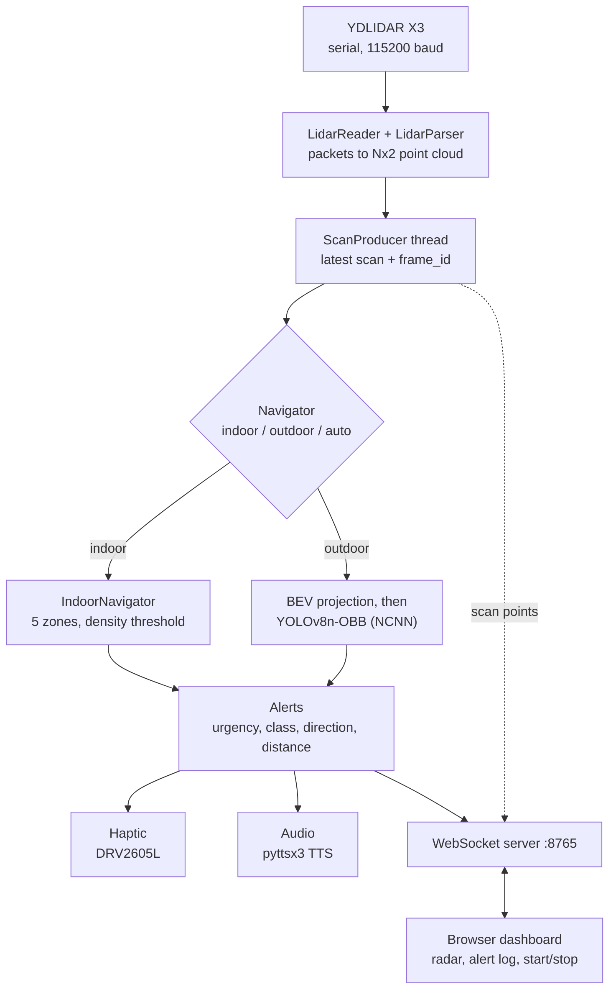

# LiDAR Navigational Aid

A real-time obstacle-detection and navigation-assistance prototype built on a 2D LiDAR and a Raspberry Pi 5. It warns the user of nearby obstacles through haptic and audio feedback, and streams live scan data to a web dashboard.

<!-- TODO: add a photo of the device and a screenshot or GIF of the dashboard, e.g. docs/images/ -->

| | |
|---|---|
| **Author** | Runch Rachapattayakhom |
| **Institution** | Yothinburana |

> **Prototype.** This project is a research and learning build, not a certified mobility aid. It must not be used in place of a cane, a guide, or your own judgement. See [Limitations and safety](#limitations-and-safety).

---
 
## Overview
 
A YDLIDAR X3 spins to produce a live 360° point cloud. The system reasons about it in one of two ways:
 
- **Indoor mode:** pure geometry. Points are bucketed into five directional zones, and an alert fires when enough points fall inside a distance threshold. No model is needed.
- **Outdoor mode:** the point cloud is projected into a Bird's-Eye-View (BEV) image and passed through a YOLOv8n-OBB model, exported to NCNN for CPU inference on the Pi, to detect cars, pedestrians and cyclists.
- **Auto mode:** chooses between the two from the average point distance of each scan, using a frame-voting scheme so a single noisy scan cannot flip the mode.
Alerts are delivered as haptic pulses (DRV2605L) and spoken phrases (pyttsx3), and can also be streamed over WebSocket to a browser dashboard that shows the scan, the current mode and the alerts, with remote start and stop.
 
## Project status
 
| Area | Status | Notes |
|---|---|---|
| LiDAR serial driver and parser | Implemented | Custom X3 packet parser, full-rotation scans |
| Indoor zone detection | Implemented | The mode the deployed service runs |
| Haptic feedback | Implemented | DRV2605L over I²C |
| Web dashboard | Implemented | Radar view, alert log, start/stop |
| Training pipeline | Implemented | KITTI → BEV → YOLOv8n-OBB → NCNN |
| Outdoor detection | **Experimental** | Trained on KITTI, not validated on real X3 scans ([why](#model)) |
| Auto mode | **Has a known issue** | See [Known issues](#known-issues) |
| Audio feedback | Stubbed | Code is ready; no speaker in the current build |
 
## How it works
 

 
### Indoor mode
 
Zones are measured from the forward axis (`x` = forward, `y` = left):
 
| Zone | Angle |
|---|---|
| ahead | −25° to 25° |
| left | 25° to 70° |
| right | −70° to −25° |
| hard-left | 70° to 100° |
| hard-right | −100° to −70° |
 
A zone raises an alert when at least **4 points** lie within **1.0 m**. The alert is `WARNING` if the closest point is under 0.5 m, otherwise `caution`. The zones cover ±100° of the forward direction; nothing behind the user is monitored.
 
### Outdoor mode
 
Points inside a 16 m × 16 m window centred on the sensor are drawn into a 320 × 320 BEV image (0.05 m per pixel) and run through the detector at a confidence threshold of 0.35. Each detection yields a class (car, pedestrian or cyclist), a direction (left, ahead, right) and an urgency level.
 
### Auto mode
 
Each scan's mean point distance decides the mode: above **4.0 m** suggests outdoor, below **3.2 m** (80% of the threshold, to avoid flapping) suggests indoor. A switch needs **5 consecutive agreeing frames**, and the system starts in indoor mode as the safer default.
 
### Feedback
 
Only the highest-priority alert of each frame is delivered.
 
| Urgency | Haptic effect (TouchSense library) | Spoken phrase |
|---|---|---|
| `WARNING` | Effect 14, sharp double-click | "*class direction*" (for example "car left") |
| `caution` | Effect 1, soft click | "caution *direction*" |
 
Speech runs in a background thread and a new phrase is dropped if the previous one is still playing, so stale alerts are never queued. Haptic pulses are a single short I²C write.
 
### Threading
 
A `ScanProducer` thread reads the LiDAR continuously and publishes the latest scan with a frame counter. The navigation loop only processes a frame when the counter changes, so inference never delays scan collection and the same scan is never processed twice. In development this roughly doubled throughput compared with the sequential first version (about 5.6 FPS to about 10 FPS). The serial reader pulls 512-byte chunks instead of single bytes, which cuts `read()` calls by about 97% (see [Engineering highlights](#engineering-highlights)).
 
## Features
 
- Custom serial driver and packet parser for the YDLIDAR X3
- Producer/consumer pipeline so scan acquisition and inference run concurrently
- Geometry-only indoor obstacle detection with no ML dependency
- YOLOv8n-OBB detection on BEV projections, running on-device through NCNN
- Automatic indoor/outdoor switching with frame voting
- Haptic and audio feedback that never blocks scan processing
- WebSocket dashboard with a live radar view and remote start/stop
- End-to-end training pipeline from KITTI point clouds to an NCNN model
- systemd services for starting the system and dashboard on boot
## Engineering highlights
 
The interesting work in this project is in the problems that came up between a working demo and a system that runs continuously on a Pi. Each row below was found, fixed and noted during development.
 
| Problem | What was done | Result |
|---|---|---|
| **Serial reading was dominated by system calls.** The first reader made several small reads per packet, and one per byte whenever it had to resync. | `LidarReader` reads 512-byte chunks into a local buffer, parses packets from memory, and only tops up when the buffer runs low. | **4.00 → 0.14 `read()` calls per packet (−96.6%)**, with byte-for-byte identical decoded packets. Measured on a synthetic X3 stream with `tests/serial_read_benchmark.py`. On-Pi timing: _TODO_ |
| **Scan collection and inference ran back to back.** The loop waited for a full rotation, then waited again for the detector. | A `ScanProducer` thread publishes the latest scan; the navigation loop always works on the newest frame and skips any it missed. | About 5.6 FPS → about 10 FPS in development measurements. Re-measure on the Pi: _TODO_ |
| **A runaway loop reprocessed the same scan** (about 127,000 "frames" at 0 ms each). | Every new scan increments a `frame_id`; the loop only processes a frame when the id changes and otherwise sleeps 10 ms. | Each scan is processed exactly once. |
| **Speech blocked the navigation loop** (about 600 ms per phrase with `pyttsx3`). | Speech runs in a daemon thread; if a phrase is still playing, the new one is dropped instead of queued, because a stale alert is worse than none. | Alerts never stall scan processing. |
| **Fixed-duration collection produced partial scans.** | Scans are collected per full rotation by detecting the angle wrap, with incomplete rotations discarded. | Every frame covers 360°. |
| **The first model call took 3–4 seconds** (NCNN compiling its layers). | A dummy inference runs when the model loads, so the layers are compiled before the first real scan. | No latency spike on the first real frame. |
| **NCNN-exported OBB models return different fields** than the PyTorch model. | Detections are read from `xywhr` (centre, size, rotation) instead of `xyxy`, which can come back empty or wrong on NCNN. | Detection output is consistent across model formats. |
| **A loose USB or serial connection would end the run.** | On a serial error the producer reconnects with exponential backoff, from 0.5 s up to a 10 s cap. | The system recovers without a restart. |
 
Also worth noting: the X3 packet protocol is parsed by hand (header sync, angle interpolation across each packet, rotation-wrap detection). No vendor SDK is used.
 
## Hardware
 
| Component | Purpose | Connection |
|---|---|---|
| YDLIDAR X3 | 360° 2D LiDAR | USB-UART adapter, exposed as `/dev/ydlidar`, 115200 baud |
| Raspberry Pi 5 | On-device inference (NCNN, CPU only) | |
| DRV2605L + 10 mm ERM motor | Haptic alerts | I²C bus 1, address `0x5A`, SDA GPIO 2, SCL GPIO 3 |
| MAX98357A + 4 Ω speaker | Audio/TTS (stubbed, not in the current build) | I²S: BCLK GPIO 18, LRCLK GPIO 19, DIN GPIO 21 |
 
## Model
 
YOLOv8n-OBB, trained for 100 epochs at 320 px on KITTI point clouds projected into BEV, then exported to NCNN.
 
| Metric | Value |
|---|---|
| mAP50 | 0.832 |
| mAP50-95 | 0.519 |
| Car (mAP50) | 0.973 |
| Pedestrian (mAP50) | 0.734 |
| Cyclist (mAP50) | 0.787 |
| Inference speed, Pi 5 CPU | about 100–177 ms per frame |
 
These are validation results on a random 80/20 split of the KITTI training frames (seed 42), trained in about 1.7 hours on an RTX 4060. Because the split is by frame, near-identical neighbouring frames can land on both sides, so treat the numbers as an upper bound.
 
### Training data versus what the X3 sees
 
The model was trained on 3D Velodyne scans and is applied to a single-plane 2D scan. The BEV images differ in several ways, which is why outdoor mode is marked experimental.
 
| | Training (KITTI) | Runtime (YDLIDAR X3) |
|---|---|---|
| Sensor | 64-beam 3D Velodyne | Single-plane 2D LiDAR |
| Area covered | 0–40 m forward, ±20 m sideways | ±8 m in every direction (360°) |
| Resolution | 0.1 m per pixel (400 × 400, resized to 320) | 0.05 m per pixel (320 × 320) |
| Sensor position in the image | Bottom centre | Image centre |
| Channels | Max height, intensity, occupancy | One constant "point present" value (no height or intensity) |
 
The runtime encoding is documented in `src/vision/bev.py`. Closing this gap, for example by fine-tuning on real X3 scans, is the main item on the roadmap.
 
### Known issues
 
1. **Auto mode never switches to outdoor.** In `AutoNavigator._update_mode` (`src/navigation/auto.py`) the vote counter is reset after every frame, so it never reaches `AUTO_SWITCH_FRAMES`. Auto mode therefore stays in indoor mode.
2. **Outdoor urgency assumes the sensor is at the bottom of the image.** `Detector.predict` (`src/vision/detector.py`) grades urgency from the vertical position of a detection (`cy`), which matches the training images. At runtime the sensor is at the image centre, so detections more than about 1 m ahead are ignored while detections behind the user can trigger `WARNING`. Direction (left, ahead, right) is unaffected.
Until these are fixed, outdoor mode should be treated as a research demo. The deployed service runs indoor mode only.
 
## Getting started
 
### Prerequisites
 
- Raspberry Pi 5 with Raspberry Pi OS, Python 3.11
- YDLIDAR X3 on USB; DRV2605L on I²C
- The project is assumed to live at **`/home/admin/research`**. That path appears in `src/config.py`, `src/server/ws_server.py` and the service files; edit those if you clone elsewhere.
### Install
 
```bash
cd ~/research
python3 -m venv venv && source venv/bin/activate
pip install numpy opencv-python pyserial ultralytics ncnn smbus2 pyttsx3 websockets
```
 
Enable I²C (`sudo raspi-config` → Interface Options → I2C) and allow serial access with `sudo usermod -aG dialout $USER`.
 
`/dev/ydlidar` is a udev symlink you create yourself. A typical rule for the X3's CP2102 adapter is shown below; confirm the vendor and product IDs with `lsusb`.
 
```bash
# /etc/udev/rules.d/99-ydlidar.rules
KERNEL=="ttyUSB*", ATTRS{idVendor}=="10c4", ATTRS{idProduct}=="ea60", MODE:="0666", GROUP:="dialout", SYMLINK+="ydlidar"
```
 
Reload with `sudo udevadm control --reload-rules && sudo udevadm trigger`.
 
### Run
 
```bash
python src/main.py                    # mode from config.py (default: auto)
python src/main.py --mode indoor      # force indoor mode
python src/main.py --mode outdoor     # force outdoor mode
python src/main.py --mode auto
 
python src/server/ws_server.py --mode indoor   # navigation loop + WebSocket for the dashboard
```
 
`ws_server.py` runs its own navigation loop, so use it **instead of** `main.py`; both open the same serial port. Press `Ctrl+C` to stop; the LiDAR is disconnected and the port closed.
 
### Run on boot with systemd
 
```bash
bash setup_dashboard_service.sh        # dashboard: python -m http.server on port 8080
cd src/server && bash setup_service.sh # navigation: ws_server.py on port 8765
```
 
| Service | What it runs |
|---|---|
| `lidar-nav` | `src/server/ws_server.py --mode indoor` |
| `lidar-dashboard` | `python -m http.server 8080` from the project root |
 
Open `http://<pi-address>:8080/src/server/dashboard.html`, enter `ws://<pi-address>:8765` in the connection box and press **Connect**. The box defaults to a fixed address, so change it for your network. Logs: `journalctl -u lidar-nav -f`.
 
> **Security.** The WebSocket accepts start/stop commands from any client with no authentication, and the dashboard server exposes the whole project directory over HTTP. Use both on a trusted network only.
 
## Configuration
 
All tunables live in `src/config.py`.
 
| Setting | Default | Meaning |
|---|---|---|
| `LIDAR_PORT` / `BAUD_RATE` | `/dev/ydlidar` / 115200 | Serial device |
| `MAX_DIST_MM` | 8000 | Readings beyond this are dropped |
| `LIDAR_ANGLE_OFFSET` | 180° | Rotation correction for how the sensor is mounted |
| `FWD_RANGE`, `SIDE_RANGE`, `RESOLUTION`, `IMG_SIZE` | ±8 m, 0.05 m/px, 320 | Runtime BEV window |
| `CONF_THRESH` | 0.35 | Minimum detection confidence |
| `MODE` | `auto` | `indoor`, `outdoor` or `auto` |
| `INDOOR_WARN_DIST` / `INDOOR_DENSITY_THRESH` | 1.0 m / 4 points | Indoor alert distance and point count |
| `LIDAR_DISTANCE_OFFSET` | +0.18 m | Calibration offset added to the closest distance |
| `AUTO_SWITCH_DIST` / `AUTO_SWITCH_FRAMES` | 4.0 m / 5 | Auto-mode threshold and vote count |
| `HAPTIC_ENABLED` / `AUDIO_ENABLED` | `True` / `False` | Feedback outputs |
| `MODEL_PATH` | `/home/admin/research/models/best_ncnn_model` | NCNN model folder |
 
## Retraining the detection model
 
Training needs a CUDA GPU and the KITTI 3D object data, arranged as `data/kitti_raw/training/{velodyne,label_2,calib}`. Create `data/bev_kitti.yaml` (the `data/` folder is git-ignored):
 
```yaml
path: data/dataset
train: images/train
val: images/val
names:
  0: car
  1: pedestrian
  2: cyclist
```
 
```bash
pip install scikit-learn
python -m src.training.convert   # KITTI → BEV images + YOLO-OBB labels
python -m src.training.train     # train YOLOv8n-OBB
python -m src.training.export    # export best.pt → NCNN, then copy to models/
```
 
## Tests
 
The scripts in `tests/` are manual hardware checks, not an automated suite:
 
- `tests/lidar_raw_test.py` dumps raw X3 packets (angles, distances, point counts) to diagnose wrap detection and distance scaling.
- `tests/lidar_bev_test.py` collects one full scan and saves BEV images; the sensor dot should sit in the centre.
- `tests/serial_read_benchmark.py` needs no hardware. It feeds the same synthetic X3 stream through the original byte-by-byte reader and the current chunked reader, counts `read()` calls, and checks that both decode identical packets. Run it on the Pi for timings.
## Limitations and safety
 
- **A single plane only.** The X3 sees one horizontal slice, so it cannot detect stairs, kerbs, drop-offs or overhanging obstacles, and it can miss thin objects.
- **Surface limits.** Glass, mirrors and very dark or reflective surfaces can give missing or wrong readings.
- **Short range.** Readings are cut off at 8 m.
- **Outdoor mode is unvalidated** on real X3 data and carries the known issues above.
- **Forward hemisphere only indoors.** Zones span ±100° of the forward direction.
- **No latency figure yet** for the full path from scan to haptic pulse.
- **Open network interfaces.** See the security note above.
## Roadmap
 
- Fix the two known issues, then re-validate auto and outdoor modes on real scans
- Collect and label X3 scans, and fine-tune the detector on them
- Measure end-to-end latency, from scan to haptic pulse
- Wire up the speaker and enable audio feedback
- Add a `requirements.txt` and remove hard-coded `/home/admin/research` paths
- Authenticate the WebSocket and restrict what the dashboard server exposes
## Acknowledgements and licences
 
- Detection built on [Ultralytics YOLOv8](https://github.com/ultralytics/ultralytics), which is released under AGPL-3.0.
- Training data: Geiger, Lenz and Urtasun, *Are we ready for autonomous driving? The KITTI vision benchmark suite*, CVPR 2012. KITTI is provided for non-commercial use; check its terms before redistributing anything derived from it.
- AGPL-3.0 License: See the LICENSE file for full details.
<details>
<summary>Windows PowerShell shortcuts for controlling the Pi</summary>
Add these to your PowerShell profile (`notepad $PROFILE`, paste, save, restart PowerShell):
 
```powershell
#── LiDAR Nav Shortcuts ────────────────────────────────────────────────
$PI_IP   = "lidarnav.local"
$PI_USER = "admin"
 
function lidar-dash    { Start-Process "http://${PI_IP}:8080/src/server/dashboard.html" }
function lidar-logs    { ssh "${PI_USER}@${PI_IP}" "journalctl -u lidar-nav -f" }
function lidar-restart {
    ssh "${PI_USER}@${PI_IP}" "sudo systemctl restart lidar-nav lidar-dashboard"
    Write-Host "Restarted lidar-nav and lidar-dashboard." -ForegroundColor Green
}
function lidar-status  { ssh "${PI_USER}@${PI_IP}" "sudo systemctl status lidar-nav lidar-dashboard --no-pager" }
function lidar-ssh     { ssh "${PI_USER}@${PI_IP}" }
function lidar-stop {
    ssh "${PI_USER}@${PI_IP}" "sudo systemctl stop lidar-nav lidar-dashboard"
    Write-Host "LiDAR nav and dashboard stopped." -ForegroundColor Red
}
 
Write-Host "LiDAR shortcuts loaded: lidar-dash | lidar-logs | lidar-restart | lidar-status | lidar-ssh | lidar-stop" -ForegroundColor Cyan
```
 
| Command | Effect |
|---|---|
| `lidar-dash` | Opens the live dashboard in your default browser |
| `lidar-logs` | Tails `lidar-nav` service logs over SSH |
| `lidar-restart` | Restarts both services |
| `lidar-status` | Shows systemd status for both services |
| `lidar-ssh` | Opens an SSH session to the Pi |
| `lidar-stop` | Stops both services |
 
</details>
